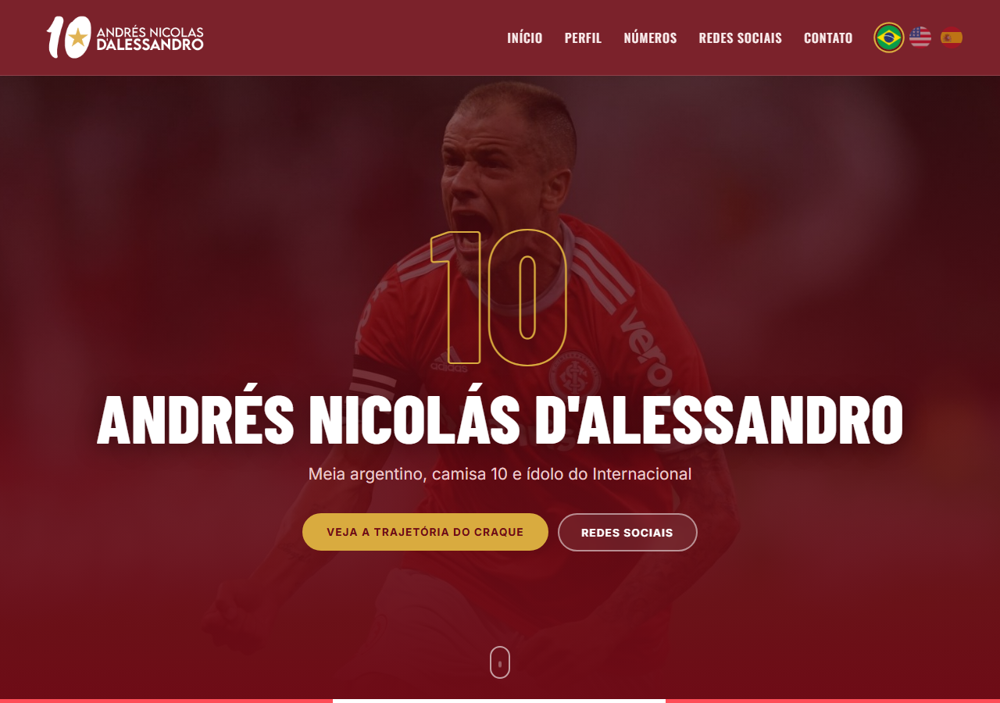
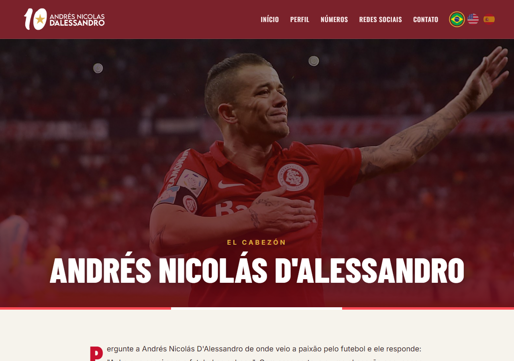

# DALE10: site de fã do D'Alessandro

Site sobre a carreira de Andrés Nicolás D'Alessandro, em português, inglês e espanhol. Projeto final da disciplina Web 1 do Curso Técnico em Informática da QI, feito por Bruno Rocha e Thiago Dias (2020) e reorganizado em 2026.

> Projeto de estudo, **sem ligação oficial** com o atleta. Textos, fotos e marcas pertencem aos respectivos donos.

| Início | Perfil |
| --- | --- |
|  |  |

## Páginas

- **Início** (`index.html`): capa, perfil com os clubes, números da carreira, redes sociais e contato (o formulário é demonstrativo: valida os campos, mas não envia nada).
- **Perfil** (`perfil.html`): a trajetória completa.
- Versões em inglês (`en/`) e espanhol (`es/`); as bandeiras levam à mesma página no outro idioma.
- Responsivo: no celular o menu vira um botão ☰ e as seções ficam em uma coluna.
- Visual nas cores do Inter: vinho, vermelho, creme e o dourado da estrela do logo.

## Como abrir

Abra o `index.html` no navegador. Não precisa de servidor nem de instalação.

As fontes (Oswald, Barlow Condensed e Inter) vêm do Google Fonts, então é preciso internet para vê-las como no projeto. Sem conexão o site funciona normalmente, só com fontes padrão do navegador.

## Estrutura

```text
index.html, perfil.html   # português
en/, es/                  # só os HTML traduzidos; usam ../css, ../js e ../img
css/estilo.css            # todo o visual, mobile first (celular, depois 640px e 960px)
js/site.js                # menu do celular, botão "voltar ao topo" e formulário de contato
img/                      # imagens compartilhadas pelos três idiomas
```

## Licença

[MIT](LICENSE) para o código.
